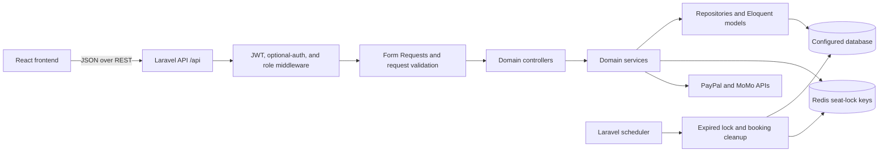
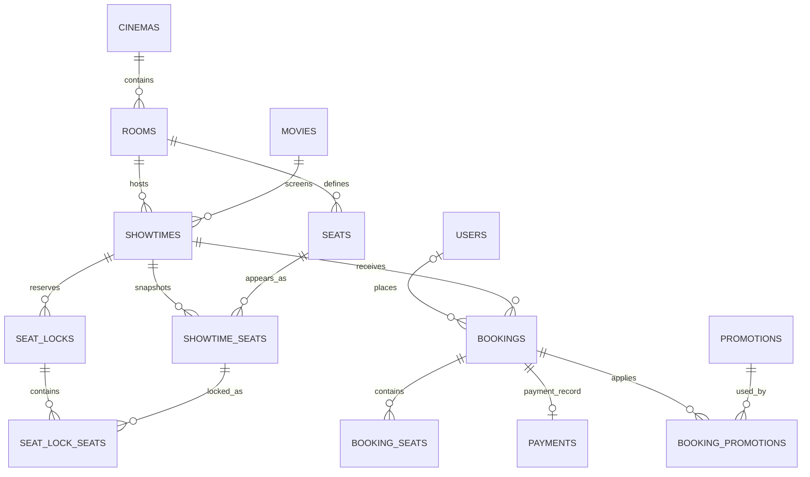

<h1 align="center">Cineon Backend</h1>

<p align="center"><strong>RESTful API and backend services for a full-stack movie booking platform.</strong></p>

<p align="center">
  Cineon’s Laravel API manages movie booking workflows, seat reservations, pricing, authentication, and payment-provider integrations.
</p>

<p align="center">
  
  
  
  
  
  
</p>

## [VIEW LIVE CINEON →](https://cineon-cinema.vercel.app/)

**[FRONTEND SOURCE CODE →](https://github.com/Quoosc/movie-booking-frontend)** · **[BACKEND SOURCE CODE →](https://github.com/Quoosc/movie-booking-backend)** · **[PERSONAL PORTFOLIO →](https://quoc-portfolio-roan.vercel.app/)**

The live demo is the Cineon frontend. This repository contains the backend API and does not provide a standalone customer-facing website. The temporary cloud demo API is `https://cineon.161.33.81.211.sslip.io/api`, with a [health endpoint](https://cineon.161.33.81.211.sslip.io/up). The API was deployed on 12 October 2026, with VPS removal planned for 20 October 2026; no automatic shutdown is scheduled. The current showtime data covers 12–16 October. Frontend Vercel environment settings must point to this URL.

## Project Overview

For the cloud demo deployment kit (MySQL, Redis, HTTPS, worker, scheduler and Vercel configuration), see [Deploy cloud demo](docs/DEPLOY-CLOUD-DEMO.md). The guide includes the deployed API status and the remaining frontend/provider configuration steps.

Cineon is a movie-booking platform. This repository contains its Laravel API: a PHP application that exposes REST endpoints to the React frontend and owns persisted booking, pricing, authentication, and payment state. Domain code is organized into modules for movies, cinemas, showtimes, bookings, payments, promotions, pricing, memberships, ticketing, and users. The API supports authenticated members and guest checkout, calculates booking totals on the server, and integrates PayPal and MoMo. For seat contention, it combines database transactions, persisted seat status, and expiring Redis locks. MySQL is configured for the Docker Compose environment; the local `.env.example` defaults to SQLite. Compose also defines Nginx, a database queue worker, and a scheduler. The engineering focus is coordinating state across browser requests, the database, Redis, and external payment providers.

## Backend Architecture



The code is grouped by business modules under `app/Modules`. Within a module, controllers handle HTTP requests, Form Requests validate selected inputs, services coordinate workflows, repositories encapsulate selected data access, and Eloquent models map persisted records. Shared authentication, middleware, support utilities, and exceptions live under `app/Core` and `app/Shared`. The modules use this organization without claiming a formal Clean Architecture or microservices design.

## Core Backend Features

| Domain | Implemented capabilities |
| --- | --- |
| Authentication & users | Email/password registration and login, JWT access tokens, refresh-token lifecycle, Google OAuth routes, profiles, membership and loyalty data, notifications |
| Movies & cinemas | Movie search and filters, movie reviews and moderation, cinema/room/seat management, snacks, hero slides |
| Showtimes & ticketing | Showtime search and administration, seat layouts and availability, ticket types, showtime-specific pricing |
| Booking | Member and guest session contexts, seat locks, server-side price preview, promotions, snacks, pending and confirmed bookings, QR ticket payloads |
| Payments | PayPal and MoMo order creation and status handling, provider verification/callbacks, administrator-initiated refunds |
| Administration | Role-protected APIs for users, movies, cinemas, showtimes, ticketing, pricing, promotions, payments, and review moderation |

## Engineering Highlight: Concurrent Seat Reservations

**Problem.** Two customers may request the same available seat for the same showtime before either has completed checkout.

**Implementation.** `BookingService` validates the showtime seats and ticket types inside a database transaction, then `RedisLockService` acquires a key per seat using Redis `SET` with `NX` and an expiry. The default lock lifetime is 10 minutes and the request is limited to 10 seats. If any lock cannot be acquired, the service releases locks acquired earlier in that attempt and returns an HTTP 423 locked-seat error; the operation is not a single multi-key Redis transaction. When all locks are acquired, the API persists the lock and its selected seats, changes their database status to `LOCKED`, and returns an expiry time. The lock owner is tied to a JWT user or guest session.

On confirmation, the service checks lock ownership and expiry, recalculates the booking price on the server, creates a `PENDING_PAYMENT` booking, marks its seats `BOOKED`, and releases the Redis locks. Successful payment moves the booking to `CONFIRMED`. A scheduled cleanup runs each minute: it releases expired seat locks and returns eligible seats to `AVAILABLE`; it also expires pending-payment bookings after their payment window. The availability API lets the client request current seat state; the backend does not implement a WebSocket or server-sent-event broadcast for seat changes.

**Benefit.** The Redis compare-and-set operation gives concurrent requests a short-lived coordination point for each seat, while SQL records the reservation and booking lifecycle. These mechanisms reduce the chance of overlapping reservations, but the repository does not include a dedicated concurrent seat-lock integration test, so this README does not claim a formal guarantee against every duplicate-booking scenario.

```mermaid
sequenceDiagram
    actor Customer
    participant API as Laravel API
    participant DB as Database
    participant Redis
    Customer->>API: POST /api/seat-locks (JWT or X-Session-Id)
    API->>DB: Validate showtime, seats, ticket types, and availability
    loop Each selected seat
        API->>Redis: SET lock:key token EX ttl NX
        Redis-->>API: Acquired or unavailable
    end
    alt Every seat lock acquired
        API->>DB: Persist SeatLock and SeatLockSeat; set seats LOCKED
        API-->>Customer: lockId, locked seats, expiresAt
        Customer->>API: POST /api/bookings/confirm (lockId)
        API->>DB: Check owner and expiry; calculate price; create PENDING_PAYMENT booking; set seats BOOKED
        API->>Redis: Release keys for this lock token
        API-->>Customer: Booking details and guest access token when applicable
    else A seat is already locked
        API->>Redis: Release keys acquired earlier in this attempt
        API-->>Customer: Seat conflict
    end
```

## Payment Processing

The API creates payment orders from a persisted booking and uses the booking’s server-calculated `final_price`; it does not rely on the amount supplied by the browser as the source of truth.

- **PayPal:** the backend obtains an OAuth access token, creates an order, and returns the provider approval URL. On capture, it checks the provider response, including completion status and captured amount/currency, before recording successful payment and updating the booking lifecycle.
- **MoMo:** the backend signs order-creation requests with HMAC-SHA256. MoMo GET/POST IPN callbacks are checked by recomputing the signature and comparing it with `hash_equals`; the handler looks up the order and validates the amount before applying a payment result. The frontend status endpoint reads the persisted result; a browser redirect alone does not confirm payment.
- **Booking lifecycle:** successful provider verification records payment completion, confirms the booking, creates the QR payload, and applies loyalty points. Payment failures and late payments have explicit lifecycle handlers.
- **Refunds:** an admin-protected API delegates to the provider-specific refund service and records refund state. Provider credentials remain server-side configuration and are not included here.

## Authentication, Authorization & API Security

| Control | Implementation in this repository |
| --- | --- |
| JWT access tokens | Custom JWT guard and middleware validate bearer tokens (or configured access-token cookies); tokens use HS256. Signing-key resolution requires at least 32 bytes of key material, using the application key to derive a domain-specific key when the configured JWT secret is shorter. |
| Refresh tokens | Refresh tokens are persisted and can be revoked; auth routes apply endpoint-specific throttling. |
| Role checks | `auth.jwt` and `role:admin` middleware protect administrative route groups. Booking and payment operations also check ownership or a guest booking capability token where required. |
| Input validation | Laravel Form Requests and controller validation rules validate fields, identifiers, and allowed payment methods. |
| Rate limiting | Login, registration, payment, review, and contact routes define explicit `throttle` middleware. These are route-level limits, not a claim of a global API limit. |
| Passwords | Registration stores passwords with Laravel's `Hash` API; login verifies with `Hash::check`. |
| CORS | Laravel CORS configuration uses the `CORS_ALLOWED_ORIGINS` environment setting and supports credentialed requests. |
| Payment notifications | MoMo IPN signatures are recomputed and compared with `hash_equals`; PayPal capture results are checked server-side. |

These controls describe the checked-in implementation; they are not a claim of independent security audit or comprehensive security testing.

## Database Design

The migrations define the booking domain and its foreign-key relationships. Docker Compose configures MySQL 8.4, while the standard `.env.example` selects SQLite by default. Select and configure the connection for the environment where the API runs.



This is a domain-level view of entities and foreign keys present in migrations. Additional tables support ticket types, snacks, refunds, membership tiers, reviews and moderation, loyalty transactions, notifications, and refresh tokens. It omits columns and does not imply a relationship where the migrations do not define one.

## REST API Overview

The Laravel API is mounted under `/api`. These representative routes are taken from `routes/api/*.php`; access notes distinguish route middleware from session or capability checks inside the workflow.

| Module | Method | Endpoint | Access |
| --- | --- | --- | --- |
| Authentication | `POST` | `/api/auth/register`, `/api/auth/login` | Public; throttled |
| Movies | `GET` | `/api/movies`, `/api/movies/{movieId}` | Public |
| Showtimes | `GET` | `/api/showtimes/search` | Public |
| Cinema seats | `GET` | `/api/seats/layout?showtime_id={id}` | Public |
| Seat reservation | `POST` | `/api/seat-locks` | JWT or `X-Session-Id` session context |
| Seat availability | `GET` | `/api/seat-locks/availability/{showtimeId}` | Optional user/session context |
| Booking price | `POST` | `/api/bookings/price-preview` | Session context; lock ownership checked |
| Booking confirmation | `POST` | `/api/bookings/confirm` | Session context; lock ownership checked |
| Combined checkout | `POST` | `/api/checkout` | Session context; confirms booking and initiates payment |
| Booking detail | `GET` | `/api/bookings/{bookingId}` | Optional JWT; owner/admin or guest capability check |
| Payment order | `POST` | `/api/payments/order` | Optional JWT; booking owner or guest capability check; throttled |
| Payment capture | `POST` | `/api/payments/order/capture` | Public, throttled; PayPal capture is verified server-side, MoMo reads persisted status |
| Payment status | `GET` | `/api/payments/order/status` | Public, MoMo status lookup; throttled |
| Payment callback | `GET`, `POST` | `/api/payments/momo/ipn` | Provider callback; signature verification in service |
| Refund | `POST` | `/api/payments/{paymentId}/refund` | JWT and admin role |
| User profile | `GET`, `PUT` | `/api/users/profile` | JWT |

For additional route details, see [API_SPEC.md](./docs/API_SPEC.md). That document is a route snapshot; the registered Laravel routes are the source of truth for current behavior.

## Technology Stack

| Category | Technology | Purpose |
| --- | --- | --- |
| Language & runtime | PHP 8.2+ (`php:8.3-fpm` in Docker) | Backend runtime |
| Framework | Laravel 12 (`12.65.0` in the lock file) | Routing, validation, persistence, middleware, scheduling |
| Database | SQLite in `.env.example`; MySQL 8.4 in Compose | Local default and containerized database configuration |
| Authentication | `firebase/php-jwt` 7.1; Laravel Socialite 5.29 | HS256 JWTs and Google OAuth integration |
| Redis client | Predis 3.5 | Redis-backed seat lock coordination |
| Payments | PayPal REST API and MoMo | Server-side order, capture/callback, and refund flows |
| Testing | PHPUnit 11.5 | Unit and feature tests |
| Containers & web server | Docker Compose, PHP-FPM, Nginx | Containerized app, database, worker, and scheduler configuration |
| Frontend assets | Vite and npm | Build the Laravel resources included in the Docker image |

## Testing & Reliability

The repository includes PHPUnit unit and feature tests. Checked-in tests cover admin-route authorization, guest booking access-token behavior, payment callback contracts, and JWT signing-key resolution. The current test suite does not include a dedicated Redis-backed concurrent-seat reservation test. No test results or coverage figures are claimed here.

Run the existing suite with:

```bash
php artisan test
```

## Docker & Runtime Configuration

`docker-compose.yml` defines these services:

| Service | Configuration |
| --- | --- |
| `app` | PHP-FPM application container; configured to run migrations at startup |
| `nginx` | Nginx 1.27; publishes container port 80 on host port 8080 |
| `db` | MySQL 8.4 with a health check and persistent volume |
| `queue` | Laravel database queue worker (`queue:work`, three tries, 90-second timeout) |
| `scheduler` | Runs `schedule:run` every 60 seconds |

The scheduler registers `locks:cleanup-expired` every minute. Compose configures the database-backed queue and cache. Redis is used by seat-lock logic, but there is no Redis service in this Compose file; configure a reachable Redis instance for that functionality. Although Compose includes a queue worker, no application job classes implementing Laravel's `ShouldQueue` were found under `app/`, so the booking flow is not described as queued processing. Docker configuration is provided, but a production deployment is not claimed as verified.

## Project Structure

```text
app/
├── Core/            # Auth guard, HTTP middleware, shared controllers
├── Modules/         # Booking, Cinema, Movie, Payment, Pricing, and other domains
├── Models/          # Eloquent models
├── Shared/          # Token, Redis lock, and cross-domain services/support
└── Console/         # Scheduled cleanup command
routes/
├── api.php          # API route registration
└── api/             # Route files organized by domain
database/
├── migrations/      # Schema and foreign-key changes
└── seeders/         # Development/initial data seeders
docker/              # Entrypoint and Nginx configuration
docs/                # API, database, flow, and architecture notes
tests/
├── Feature/
└── Unit/
```

## Getting Started

Requirements: PHP 8.2+, Composer, and the extensions/dependencies required by Laravel. For the SQLite default in `.env.example`, a local database file must exist before migrations.

```bash
composer install
cp .env.example .env
touch database/database.sqlite
php artisan key:generate
php artisan migrate
php artisan serve --port=8000
```

Configure local JWT, CORS, Redis, OAuth, and payment settings as needed using the variable names in `.env.example` and `config/`. Do not copy secrets into this README. For Docker, `.env.docker.example` and `docker-compose.yml` show the available configuration; Redis still needs to be provided separately for seat-lock operations.

## My Contributions

As the full-stack developer on Cineon, I contributed to the Laravel API and its integration with the React application. My backend work includes domain API development, JWT and role-protected workflows, member and guest booking paths, seat reservation processing, server-calculated pricing, and PayPal/MoMo payment handling. The repository history for this checkout is authored under `Quoosc`; feature descriptions above are grounded in the implementation and do not claim that every subsystem was developed individually by one person.

## Project Links & Contact

- **Live Demo:** [Cineon movie booking application](https://cineon-cinema.vercel.app/) (frontend)
- **Frontend:** [github.com/Quoosc/movie-booking-frontend](https://github.com/Quoosc/movie-booking-frontend)
- **Backend:** [github.com/Quoosc/movie-booking-backend](https://github.com/Quoosc/movie-booking-backend)
- **Portfolio:** [quoc-portfolio-roan.vercel.app](https://quoc-portfolio-roan.vercel.app/)
- **GitHub:** [github.com/Quoosc](https://github.com/Quoosc)
- **Email:** [phamquoc896@gmail.com](mailto:phamquoc896@gmail.com)
